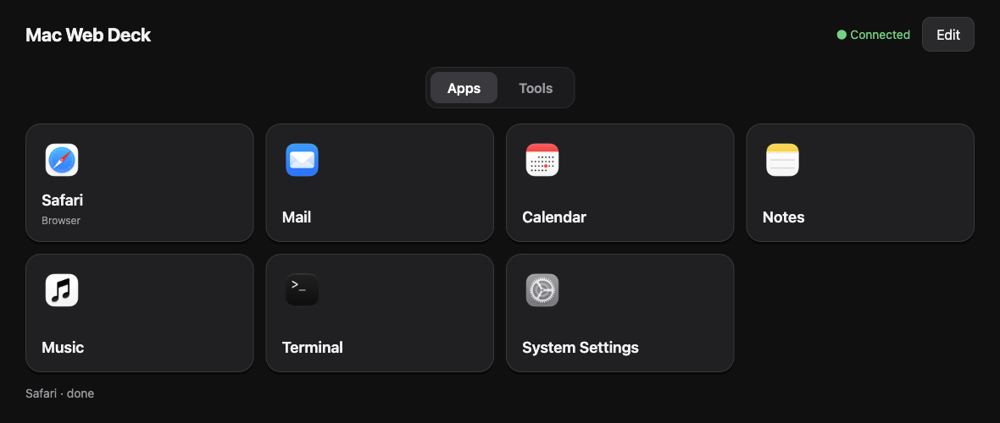
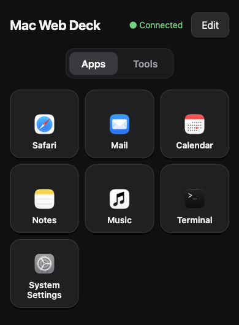
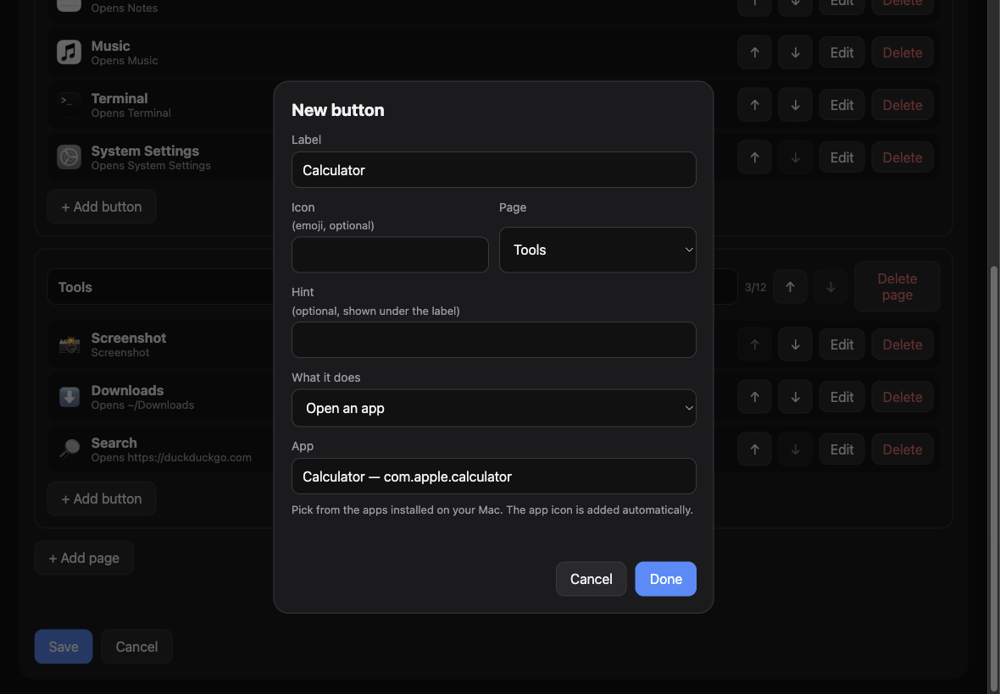

# Mac Web Deck

같은 Wi-Fi의 브라우저에서 쓰는 맥 버튼판입니다.
쓰지 않는 iPad나 휴대폰을 키보드 옆에 두고 버튼을 누르면, 맥에서 앱·폴더·웹페이지가 열리거나 단축어가 실행됩니다.

[English](README.md)

<p>
  
  
</p>

- 휴대폰·태블릿에 앱을 설치할 필요가 없습니다. 최신 브라우저면 되고, 홈 화면에 추가할 수도 있습니다.
- 메뉴는 브라우저에서 꾸밉니다. 버튼과 페이지를 추가·삭제하고 순서를 바꿀 수 있습니다. 앱은 맥에 설치된 앱 목록에서 고르면 아이콘이 자동으로 붙고, 단축어도 목록에서 고릅니다.
- 의존성 없는 작은 코드라서 직접 또는 Claude Code 같은 AI 코딩 도구로 고쳐 쓰기 쉽습니다. 아래 'Claude Code로 고쳐 쓰기'를 참고하세요.

## 필요한 것

- macOS
- Node.js 22.6 이상(`node --version`으로 확인). [nodejs.org](https://nodejs.org)나 Homebrew(`brew install node`)로 설치합니다.
- 맥과 브라우저 기기가 같은 네트워크에 있어야 합니다.

## 설치와 실행

```bash
git clone https://github.com/svmark/mac-web-deck.git
cd mac-web-deck
npm start
```

서버가 접속 주소와 6자리 연결 코드를 보여 줍니다. iPad나 휴대폰에서 그 주소를 열고 코드를 넣으면 연결됩니다. 연결은 서버를 다시 시작해도 유지됩니다.

- 다른 기기용 새 코드: `npm run pair` (서버가 켜져 있을 때)
- 로그인할 때 자동 실행: `npm run autostart:install` (해제는 `npm run autostart:remove`). 기록은 `.runtime/server.out.log`에 남습니다.
- 연결된 브라우저 모두 해제: `npm run forget-browsers`
- 다른 포트 사용: `PORT=4400 npm start`

처음 실행하면 `deck.example.json`을 복사해 `deck.json`을 만듭니다. 내 메뉴는 `deck.json`에 저장되며 git에는 올라가지 않습니다.

## 메뉴 꾸미기

브라우저에서 **Edit**를 누릅니다.



- **페이지**: 이름 바꾸기, 순서 바꾸기(↑ ↓), 추가(최대 8개), 삭제
- **버튼**: 페이지당 최대 12개. 추가, 수정, 순서 바꾸기, 다른 페이지로 옮기기, 삭제
- 버튼이 할 수 있는 일
  - **앱 열기**: 앱 이름을 입력해 고르면 아이콘이 자동으로 붙습니다.
  - **폴더·파일 열기**: `~/Documents`, `/Applications` 같은 경로
  - **웹페이지 열기**: 맥의 기본 브라우저로 엽니다.
  - **단축어 실행**: 단축어 앱의 단축어를 고릅니다. 음악 조작, 집중 모드, 스크립트 실행 등 거의 모든 일을 단축어로 만들 수 있어서, 코드 없이 나만의 동작을 추가하는 방법입니다.
  - **스크린샷**: macOS 캡처 도구를 엽니다.
- 이모지 아이콘과 짧은 설명 줄은 선택입니다.

**Save**를 누르면 `deck.json`에 저장되고, 연결된 브라우저 모두 2초 안에 바뀝니다. 이전 설정은 `.runtime/backups/`에 최근 20개까지 남습니다.

## 보안

실행하기 전에 읽어 주세요.

- 네트워크에서 이 맥에 접속할 수 있고 **연결을 마친** 브라우저라면 누구나 버튼을 실행할 수 있습니다. 연결에는 맥에만 표시되는 6자리 코드가 필요합니다. 코드는 한 번만 쓸 수 있고 10분 뒤 만료되며 10번까지 시도할 수 있습니다.
- 통신은 로컬 네트워크의 HTTP입니다(암호화 없음). 집처럼 믿을 수 있는 네트워크에서만 쓰고, 포트를 인터넷에 열지 마세요.
- 버튼은 메뉴에 등록된 동작만 실행합니다. 위의 다섯 가지 동작이 정해진 macOS 명령으로만 실행되고, 셸을 거치지 않습니다. 요청으로 임의의 명령을 실행할 수 없습니다.
- 다른 웹사이트가 브라우저를 통해 이 서버를 조작하지 못하도록 `Host`와 `Origin`을 검사합니다.
- 기기를 잃어버리면 `npm run forget-browsers`로 모든 연결을 해제하세요.

## Claude Code로 고쳐 쓰기

TypeScript 파일 몇 개와 HTML·CSS·JS로만 이뤄져 있어 AI 도구가 전체를 읽고 고치기 쉽습니다. [`CLAUDE.md`](CLAUDE.md)에 구조, 지켜야 할 규칙, 자주 하는 작업 순서가 있고 Claude Code가 자동으로 읽습니다.

이 폴더를 Claude Code로 열고 이렇게 요청해 보세요.

- "맥 음소거를 켜고 끄는 버튼 종류를 추가해 줘."
- "iPad에서 버튼을 더 크게, 밝은 테마로 바꿔 줘."
- "단축어로 재생/일시정지, 다음 곡, 이전 곡 버튼이 있는 미디어 페이지를 만들어 줘."
- "헤더에 맥 배터리 잔량을 보여 줘."

새 동작은 정해진 명령과 검증된 값으로만 만들고, '아무 명령이나 실행하는 버튼'은 만들지 않는 것이 `CLAUDE.md`의 보안 원칙입니다.

## 라이선스

MIT. [LICENSE](LICENSE)를 참고하세요.
