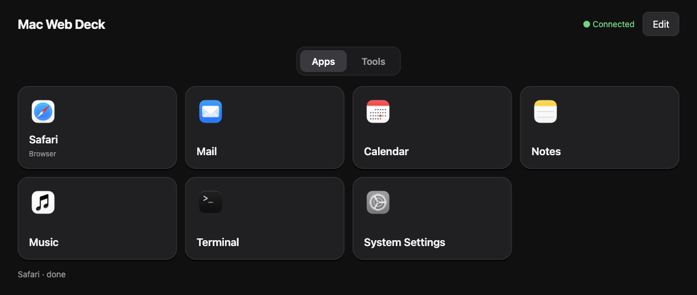
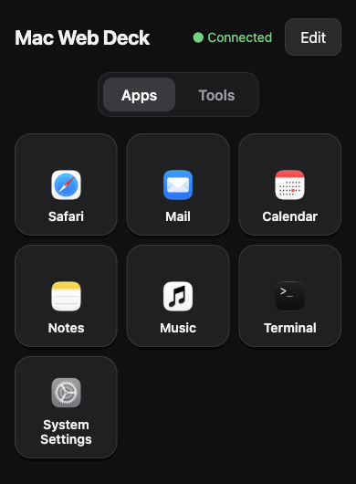
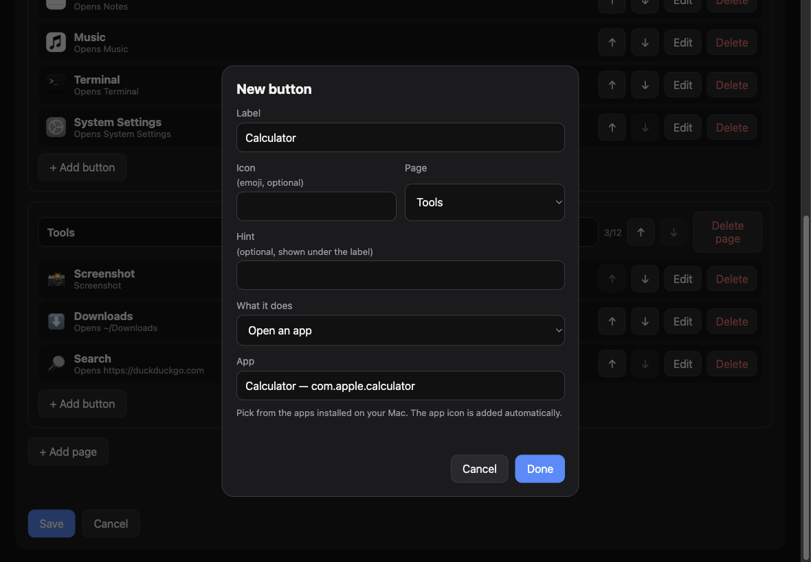

# Mac Web Deck

A touch control panel for your Mac that runs in any browser on your Wi-Fi.
Put an old iPad or your phone next to the keyboard, tap a button, and your Mac opens an app, a folder, a web page, or runs a Shortcut.

[한국어 안내](README.ko.md)

<p>
  
  
</p>

- No app to install on the phone or tablet. Any modern browser works, and you can add it to the Home Screen.
- Build your deck in the browser: add, remove and reorder buttons and pages, pick apps from the ones installed on your Mac (icons are added automatically), pick Shortcuts from your Shortcuts library.
- Small codebase with no dependencies, so you can extend it yourself or with an AI coding assistant such as Claude Code. See [Customize with Claude Code](#customize-with-claude-code).

## Requirements

- macOS
- Node.js 22.6 or later (`node --version`). Install from [nodejs.org](https://nodejs.org) or with Homebrew (`brew install node`).
- The Mac and the browser device on the same network.

## Install and run

```bash
git clone https://github.com/svmark/mac-web-deck.git
cd mac-web-deck
npm start
```

The server prints the addresses to open and a 6-digit pairing code:

```
Mac Web Deck is running.
  On this Mac:   http://localhost:4310
  Other devices: http://your-mac.local:4310
Pairing code: 123456 (valid 10 minutes, single use)
```

Open the address on your iPad or phone, enter the code, and you are paired. The pairing is remembered, also after the server restarts.

- New code for another device: `npm run pair` (while the server is running).
- Start automatically when you log in: `npm run autostart:install` (remove with `npm run autostart:remove`). Logs go to `.runtime/server.out.log`; `npm run pair` then shows the new code there.
- Unpair every browser: `npm run forget-browsers`.
- Use another port: `PORT=4400 npm start`.

The first run creates `deck.json` from `deck.example.json`. Your deck lives in `deck.json` (not tracked by git).

## Build your deck

Tap **Edit** in the browser.



- **Pages**: rename, reorder (↑ ↓), add (up to 8) or delete.
- **Buttons**: up to 12 per page. Add, edit, reorder, move to another page, or delete.
- Each button does one of:
  - **Open an app**: start typing the app name and pick it. The icon is taken from the app.
  - **Open a folder or file**: a path such as `~/Documents` or `/Applications`.
  - **Open a web page**: an `http` or `https` address, opened in the Mac's default browser.
  - **Run a Shortcut**: pick a shortcut from the Shortcuts app. Shortcuts can do almost anything (control music, toggle Focus, run scripts), so this is the way to add your own actions without code.
  - **Take a screenshot**: opens the macOS screenshot tool.
- Optional emoji icon and a short hint line under the label.

**Save** writes `deck.json` and every connected browser updates within a couple of seconds. The previous version is kept in `.runtime/backups/` (last 20).

You can also edit `deck.json` by hand and restart the server.

## Security

Read this before you run it.

- Anyone who can reach the Mac on your network **and** has paired a browser can trigger the buttons on your deck. Pairing needs the 6-digit code that only the Mac shows; a code works once and expires after 10 minutes, with 10 attempts at most.
- Traffic is plain HTTP on your local network. Use it on a network you trust (home, not a café). Do not forward the port to the internet.
- A button can only do what is on the deck: the five action types above, with fixed macOS commands and no shell. Nothing in a request can run an arbitrary command.
- The server checks the `Host` and `Origin` headers to block other websites from driving it through your browser.
- Paired browsers are stored as hashes in `.runtime/sessions.json`. Lost a device? Run `npm run forget-browsers`.
- macOS may ask for permission the first time a Shortcut or app is controlled. Approve only what you expect.

## Customize with Claude Code

The project is intentionally small (a few TypeScript files, plain HTML/CSS/JS, no build step, no dependencies) so an AI assistant can read all of it. [`CLAUDE.md`](CLAUDE.md) explains the structure, the rules, and the steps for common changes, and Claude Code reads it automatically.

Open the folder in Claude Code and ask, for example:

- "Add a button type that toggles the Mac's mute and shows a speaker icon."
- "Make the tiles bigger on iPad and use a light theme."
- "Add a page of media buttons: play/pause, next, previous, using Shortcuts."
- "Show the Mac's battery level in the header."
- "Let a button open a URL in a specific browser (Chrome) instead of the default."

Keep the security rules in `CLAUDE.md`: new actions must be fixed commands with validated arguments, never "run this command" buttons.

## Project layout

| File | What it does |
|---|---|
| `server.ts` | HTTP server, pairing, API, running buttons |
| `config.ts` | Deck format, validation, action → command |
| `apps.ts` | Installed apps, app icons, Shortcuts list |
| `sessions.ts` | Remembered browsers |
| `public/` | The web app (deck and editor) |
| `scripts/admin.ts` | `npm run pair`, autostart, forget browsers |
| `server.test.ts` | Tests (`npm test`) |

## License

MIT. See [LICENSE](LICENSE).
